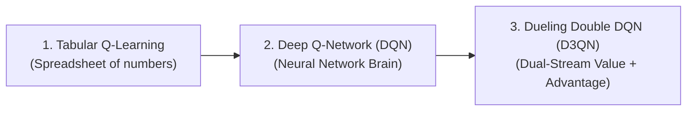

# Complete Developer & Beginner's Guide: Food Delivery Route Optimization with Machine Learning

Welcome! If you are the developer of this project and feel like you "know nothing" or only vaguely remember what a train/test split is, **you are in the right place**. 

This document explains **every single concept, design decision, mathematical intuition, and line of architecture** in this project from the absolute ground up. No unnecessary jargon. No hand-waving.

---

## Table of Contents
1. [The Big Picture: What Problem Are We Solving?](#1-the-big-picture-what-problem-are-we-solving)
2. [Why Reinforcement Learning (RL) Instead of Normal Machine Learning?](#2-why-reinforcement-learning-rl-instead-of-normal-machine-learning)
3. [Why Do We Need an "Environment" (`env.py`, `env_multi.py`)?](#3-why-do-we-need-an-environment-envpy-env_multipy)
4. [Why Do We Need Seeds (`seed=42`, `map_seed=0`)?](#4-why-do-we-need-seeds-seed42-map_seed0)
5. [Why Do We Split Data (Train, Validation, Test)?](#5-why-do-we-split-data-train-validation-test)
6. [Data Cleaning Pipeline (`clean_data.py`): Why Every Step Exists](#6-data-cleaning-pipeline-clean_datapy-why-every-step-exists)
7. [The Algorithms: From Simple to Advanced](#7-the-algorithms-from-simple-to-advanced)
   - [Algorithm 1: Tabular Q-Learning](#algorithm-1-tabular-q-learning)
   - [Algorithm 2: Deep Q-Network (DQN)](#algorithm-2-deep-q-network-dqn)
   - [Algorithm 3: Dueling Double DQN (D3QN)](#algorithm-3-dueling-double-dqn-d3qn)
8. [Single-Order vs. Multi-Order Delivery](#8-single-order-vs-multi-order-delivery)
9. [How We Evaluate & Test Everything (`evaluate.py`, Baselines & Metrics)](#9-how-we-evaluate--test-everything-evaluatepy-baselines--metrics)
10. [The Streamlit Web App (`app.py` & Pages)](#10-the-streamlit-web-app-apppy--pages)
11. [How to Set Up Your Environment & Run Everything (Step-by-Step)](#11-how-to-set-up-your-environment--run-everything-step-by-step)

---

## 1. The Big Picture: What Problem Are We Solving?

Imagine you run **Zomato** (or GrabFood / UberEats).
A rider picks up a burger from a restaurant and must deliver it to a customer's doorstep within 45 minutes.

On a simple day, Google Maps or a straight line is enough. But real cities are chaotic:
- **Heavy Rain or Fog**: Roads get slippery, visibility drops, and delivery times increase.
- **Traffic Jams**: Rush hour turns a 5-minute trip into a 25-minute nightmare.
- **Congestion Hotspots**: Certain intersections, market streets, or construction areas are bottlenecks.
- **Multiple Orders at Once**: A single rider picks up 2 or 3 orders from nearby restaurants and must decide: *Who do I deliver to first? What path minimizes total delivery delay without letting anyone's food turn cold?*

### The Goal of This Project
We build intelligent AI agents that learn to navigate a grid city, make smart turn-by-turn routing decisions, avoid traffic jams and weather hazards, and deliver food on time.

---

## 2. Why Reinforcement Learning (RL) Instead of Normal Machine Learning?

Most people are introduced to Machine Learning via **Supervised Learning**:
- You show an AI 10,000 photos of cats and dogs, labeled "Cat" or "Dog".
- The AI learns a formula: `Input -> Prediction`.
- If the AI is wrong, you tell it the right answer immediately.

### Why Supervised Learning Fails for Route Optimization
Driving is **not** a single one-shot prediction:
1. Routing is a **sequential decision process**. Every move you make changes where you are, what options you have next, and how much time remains.
2. If the AI makes one bad turn at minute 2, it is now in a totally different part of the city. A static dataset doesn't have an "answer key" for every conceivable mistake a rider might make.
3. You don't care about just one turn; you care about the **entire cumulative journey** (reaching the customer safely, quickly, and on time).

### Enter Reinforcement Learning (The Video Game / Puppy Analogy)
Reinforcement Learning (RL) works exactly like training a puppy or playing Super Mario:
- There is no answer key.
- The AI (**Agent**) is placed in a world (**Environment**).
- The agent takes an **Action** (Move Up, Down, Left, or Right).
- The environment gives **Feedback**:
  - A positive reward (+50 points) when the food is delivered!
  - A penalty (-1 point) for every minute spent traveling (encouraging speed).
  - A heavy penalty (-2 points) if it crashes into a boundary wall.
  - An extra delay and cost if it drives through a congested traffic hotspot.
- Through thousands of trials and errors, the AI figures out: *"If it's raining and the main boulevard is jammed, taking the side alley gets me +45 reward, while the main road gives me -15. I should take the side alley!"*

---

## 3. Why Do We Need an "Environment" (`env.py`, `env_multi.py`)?

You cannot train a self-driving delivery AI on real streets using real motorbikes. Crashing 10,000 bikes in Mumbai or Bangalore would cost millions and injure people.

Instead, we build a **software simulation of the city**: this is called the **Environment**.

### What Does `env.py` Do?
In our project, the environment represents a **10x10 city grid**:
- **State / Observation**: What the rider can "see":
  - Rider position: `(row, col)`
  - Destination position: `(dest_row, dest_col)`
  - Current traffic density: Low, Medium, High, or Jam (extracted from the Zomato dataset!)
  - Current weather: Sunny, Cloudy, Fog, Rain, etc.
  - Delivery time limit / benchmark time recorded in the real order.
- **Actions**: Exactly 4 discrete moves:
  - `0`: Move Up (North)
  - `1`: Move Down (South)
  - `2`: Move Left (West)
  - `3`: Move Right (East)
- **Step Function (`step(action)`)**:
  - Moves the rider one cell.
  - Calculates travel time based on:
    $$\text{Minutes} = 2.0 \times (1 + 0.25 \times \text{traffic} + 0.15 \times \text{weather}) \times (\text{hotspot multiplier})$$
  - Checks if the rider reached the destination:
    - If yes: `terminated = True`, give `+50.0` points (minus late penalty if slower than the real driver).
    - If hit max steps (60 steps): `truncated = True`, give `-20.0` timeout penalty.
- **Reset Function (`reset()`)**:
  - Picks a real delivery order from our cleaned dataset.
  - Places the restaurant and customer on the grid at a distance corresponding to the real-world GPS kilometers.
  - Spawns congestion hotspots.

---

## 4. Why Do We Need Seeds (`seed=42`, `map_seed=0`)?

Computers cannot generate truly random numbers. Instead, they use a formula that generates a sequence of numbers that *look* random. This is called a **Pseudo-Random Number Generator (PRNG)**.

A **Seed** is the starting number fed into this formula.

### Why is This Crucial? (The Fair Test Principle)
Imagine two students take a math test:
- Student A gets an exam with simple 1-digit addition: $2 + 3 = ?$
- Student B gets an exam with advanced calculus: $\int x^2 dx = ?$
- Student A scores 98%, and Student B scores 65%. Is Student A smarter? **No! The test was unfair.**

In our project:
- If we test **Q-Learning**, **DQN**, and **D3QN** without seeds, Model 1 might get 500 sunny, low-traffic trips with no obstacles, while Model 3 gets 500 stormy, traffic-jammed trips.
- By setting `reset(seed=ep)` where `ep = 0, 1, 2, ... 499`:
  - Episode #0 is **identical** for all models: same start cell, same customer cell, same traffic, same weather.
  - Episode #1 is **identical** for all models.
  - This guarantees an **apples-to-apples fair comparison**!

### What Does `map_seed=0` vs `map_seed=202` Mean?
- In `env.py`, `map_seed=0` sets where the red "hotspot" congestion zones are placed.
- If we train the agent on `map_seed=0` and test it on `map_seed=0`, we are testing: *"Can the agent memorize the streets of its home town?"*
- If we test it on `map_seed=202` (an unseen map), we are testing: *"Can the agent generalize to a brand new neighborhood it has never seen before?"*

---

## 5. Why Do We Split Data (Train, Validation, Test)?

Suppose a student memorizes the exact answers to 100 practice questions. If the teacher puts those exact same 100 questions on the final exam, the student gets 100%. But do they understand math? No! If you change a single number, they fail. In machine learning, this is called **Overfitting**.

To prevent cheating and measure real intelligence, we split our 40,482 real Zomato orders into separate partitions:

```
Total Cleaned Orders (40,482)
│
├── Training Set (64% or 70% or 80%)
│   └── The homework practice questions. The AI plays in the environment 
│       using these orders to learn how to drive.
│
├── Validation Set (16% or 15%)
│   └── The mock practice quiz. The developer uses this to tune hyperparameters 
│       (e.g. learning rate, neural network size) to see what works best.
│
└── Test Set (20% or 15%)
    └── The final exam locked in a safe! Never touched during training or tuning.
        Evaluated ONCE at the end to generate our final scientific report.
```

### The 3 Splits Used in This Project (Protocol Summary)
1. **80 / 20 Split (`shared.py`, seed 42)**: The historical split used for initial experiments and loaded by the interactive Streamlit dashboard (`app.py`).
2. **64 / 16 / 20 Split (`compare/part_a_comparison.py`, seed 42)**: Preserves the same 20% test rows, but cleanly separates the 80% development data into 64% train and 16% validation.
3. **70 / 15 / 15 Split (`env_multi.py`, seed 42)**: Used for all multi-order D3QN experiments (28,338 train / 6,072 val / 6,072 test).

---

## 6. Data Cleaning Pipeline (`clean_data.py`): Why Every Step Exists

Real-world datasets are messy, corrupt, and full of human errors. The raw Zomato dataset had **45,584 rows**. After running `clean_data.py`, we have **40,482 clean, trustworthy rows**.

Here is why each cleaning stage exists:

| Stage | What We Cleaned | Why We Did It (The Real-World Reason) | Rows Left |
|---|---|---|---|
| **Raw Data** | Kaggle Zomato CSV | Original download | 45,584 |
| **1. Strip Text & Fix 'NaN'** | Stripped whitespace, replaced `"NaN "` with null | Someone entered strings like `"conditions NaN "` with spaces. In Python, `"NaN "` is considered a valid string, not empty! | 45,584 |
| **2. Target Column** | Extracted numbers from `"(min) 24"` $\rightarrow$ `24` | Delivery duration had text mixed with numbers. Machine learning needs raw numeric minutes. | 45,584 |
| **3. Drop Duplicates** | Removed exact duplicate rows | Having identical rows in both train and test causes data leakage (cheating). | 45,584 |
| **4. Fix / Drop GPS Coordinates** | Took `abs(lat)`, dropped coordinates near 0 | - Some delivery boys entered `-12.97` instead of `+12.97` (sign error in India).<br>- `(0.0, 0.0)` is "Null Island" in the Atlantic Ocean! | 41,393 |
| **5. Haversine Distance < 50 km** | Calculated great-circle distance on Earth sphere | Deliveries > 50 km are GPS tracking glitches. No rider delivers soup 80 km across cities on a scooter. | 41,135 |
| **6. Drop Missing Traffic / Weather** | Dropped rows missing traffic or weather | Our environment simulator requires weather and traffic to calculate realistic delays. | 40,482 |
| **7. Fill Age & Rating with Median** | Missing driver age/rating filled with median | Not used directly in our grid movement, so we preserve the rows instead of throwing them away. | 40,482 |
| **8. Flag Outliers (IQR rule)** | Marked extreme delivery times without deleting | A delivery taking 120 minutes during a monsoon is unusual, but it represents real life. We flag it for analysis. | **40,482** |

---

## 7. The Algorithms: From Simple to Advanced

This project implements three generations of Reinforcement Learning algorithms to show clear architectural progression.



---

### Algorithm 1: Tabular Q-Learning (`q_learning/`)

#### How it Works (The Cheat Sheet Analogy)
Imagine a giant printed Excel table:
- Each **row** is a state: e.g. `(Rider=(2,3), Destination=(5,7), Traffic=High)`
- Each **column** is an action: `[Up, Down, Left, Right]`
- Inside each cell is a score called the **Q-Value** (Quality of taking that action in that state).

When the rider is at `(2,3)`, it looks at that row, finds the column with the highest Q-value, and takes that move!
After taking the move, it updates the cell using the famous **Bellman Equation**:
$$Q(s, a) \leftarrow Q(s, a) + \alpha \left[ r + \gamma \max_{a'} Q(s', a') - Q(s, a) \right]$$
Where:
- $\alpha$ (Alpha / Learning Rate): How fast the AI overwrites old knowledge with new knowledge.
- $\gamma$ (Gamma / Discount Factor): How much the AI cares about long-term future rewards vs. immediate rewards (e.g. 0.95 means it cares deeply about reaching the final customer).

#### The Breakthrough in Part A: Curse of Dimensionality
- **v1 State (Raw Coordinates)**:
  $$\text{States} = 10 \times 10 \text{ (Rider pos)} \times 10 \times 10 \text{ (Customer pos)} \times 4 \text{ (Traffic)} = \mathbf{40,000 \text{ states!}}$$
  With 40,000 states, the table is too big. In 5,000 training trips, the agent only visits a tiny fraction of cells. In testing, it encounters an unseen state and has no idea what to do. **Success rate was only 5.2%!**
- **v2 State (Relative Feature Engineering)**:
  Instead of memorizing absolute coordinates, we tell the rider:
  - Direction to customer: `(sgn_r, sgn_c)` $\in \{-1, 0, +1\}$ ("Is the customer North, South, East, or West of me?")
  - Radar sensors: What is directly Up, Down, Left, Right? (0 = clear road, 1 = hotspot, 2 = wall).
  - This compresses 40,000 states down to **~350 universal states**!
  - **Result: Delivery success shot up from 5.2% to 92.4%!**

---

### Algorithm 2: Deep Q-Network / DQN (`dqn/`)

#### Why Replace the Table with a Neural Network?
In real cities, streets have continuous GPS coordinates, dozens of traffic signals, and hundreds of variables. A lookup table cannot scale to millions of states.

A **Deep Q-Network (DQN)** replaces the table with a Deep Neural Network (MLP):
- **Input**: The state vector (e.g., rider position, destination, traffic, weather, time left).
- **Hidden Layers**: Dense layers (e.g., 128 neurons with ReLU activation) that learn nonlinear spatial features.
- **Output**: 4 numbers representing the Q-value for `[Up, Down, Left, Right]`.

#### Two Crucial Tricks That Make DQN Work
1. **Experience Replay Buffer (`ReplayBuffer`)**:
   - In standard learning, steps occur sequentially: step 1, step 2, step 3. Consecutive steps look almost identical, which biases neural networks.
   - We store memories `(state, action, reward, next_state, done)` into a giant memory bank of 50,000 experiences.
   - During training, we randomly pull a batch of 64 memories from across history. This breaks correlation and stabilizes training.
2. **Target Network**:
   - In the Bellman equation, the target is $r + \gamma \max_{a'} Q(s', a')$.
   - If the same network predicts both the current value and the target, it's like a dog chasing its own tail: every time the weights update, the target moves!
   - We maintain two identical networks: **Online Network** (learns every 4 steps) and **Target Network** (frozen, and only updated periodically every 500 steps).

---

### Algorithm 3: Dueling Double DQN / D3QN (`d3qn/`)

D3QN combines two major algorithmic breakthroughs:

#### 1. Double DQN (Fixes Overestimation Bias)
Standard DQN uses $\max_{a'} Q_{\text{target}}(s', a')$ to pick the best future reward. Because of random noise, taking the maximum always picks the overly optimistic, overestimated value.
- **Double DQN Solution**:
  - Use the **Online Network** to *choose* which action is best: $a^* = \arg\max_a Q_{\text{online}}(s', a)$
  - Use the **Target Network** to *evaluate* that action's value: $Q_{\text{target}}(s', a^*)$
  - This completely eliminates overestimation!

#### 2. Dueling Architecture (Separates "Where I Am" from "What I Do")
In many states, it doesn't matter whether you go Left or Right; being in a bad spot (e.g., trapped in a storm in a traffic jam) is bad regardless of your move.
Dueling DQN splits the final layers into two separate streams:
1. **Value Stream $V(s)$**: Scalar representing how good this state is overall.
2. **Advantage Stream $A(s, a)$**: Vector representing how much better this specific move is compared to the other moves.

They are combined using:
$$Q(s, a) = V(s) + \left( A(s, a) - \frac{1}{|\mathcal{A}|} \sum_{a'} A(s, a') \right)$$

This allows the network to learn the value of a state without having to test every single action in that state!

---

## 8. Single-Order vs. Multi-Order Delivery

### Single-Order (`env.py`)
- One restaurant, one customer.
- Straightforward point A to point B navigation.
- All algorithms (Q-Learning, DQN, D3QN) perform well here (~99-100% delivery rate).

### Multi-Order Vehicle Routing (`env_multi.py`)
- Real delivery riders carry up to **3 customer orders** simultaneously!
- **Dynamic Arrival**: While delivering order #1, an emergency notification pops up: a new order #2 was placed nearby!
- **Combinatorial Complexity**: The agent must decide:
  - Do I drop off Customer 1 first, or detour slightly to drop off Customer 2 because their food was picked up earlier?
  - How do I avoid accumulating late penalties across 3 customers?
- **Why D3QN Wins**: In multi-order scenarios, simple heuristics (Greedy) fail because they greedily rush to the nearest customer, leaving distant customers stranded past the 45-minute SLA. D3QN learns strategic multi-stop routes that beat Greedy by **+4.35 reward** and close 84% of the gap to an omniscient Dijkstra planner.

---

## 9. How We Evaluate & Test Everything (`evaluate.py`, Baselines & Metrics)

To prove our AI is truly superior, we benchmark it against three standard baselines:

```
[Random Agent]       Monkey pushing buttons randomly. (~0-5% success rate).
       ▼
[Greedy Agent]       Always moves in the direction that decreases distance to customer.
                     (Blind to traffic and congestion hotspots; gets trapped).
       ▼
[Learned AI (D3QN)]  Intelligently balances distance, traffic avoidance, and SLA timers.
       ▼
[Dijkstra Planner]   Omniscient oracle that knows the full map and calculates theoretical shortest cost.
```

### The 8 Standardized Metrics
Whenever we test an agent across 500 trips, we measure:
1. **`success_rate`**: Percentage of trips delivered before the 60-step timeout.
2. **`on_time_rate`**: Proxy percentage delivered faster than the real-world historical driver's time.
3. **`avg_reward`**: Mean cumulative reward (higher is better).
4. **`std_reward`**: Consistency of the strategy (lower variance = more reliable).
5. **`avg_steps`**: Average grid moves per trip.
6. **`route_efficiency`**: Theoretical shortest Manhattan distance divided by actual steps (1.0 = perfect straight line).
7. **`avg_delivery_time_min`**: Total simulated travel minutes.
8. **`avg_hotspot_steps`**: How many congested red cells the agent entered (fewer is better).

### What is a "Paired Bootstrap 95% Confidence Interval"?
In research, saying "My AI scored 32.5 and Greedy scored 28.1" is not enough. Reviewers will ask: *Did you just get lucky?*
- We take the 2,000 test trips.
- We take the difference for each trip: $\Delta_i = \text{Reward}(\text{D3QN})_i - \text{Reward}(\text{Greedy})_i$.
- We resample these differences 5,000 times to create a bell curve.
- If the 95% interval is `[+4.09, +4.61]`, zero is NOT in the interval. This is **rigorous mathematical proof** that D3QN is statistically superior to Greedy!

---

## 10. The Streamlit Web App (`app.py` & Pages)

We built an interactive, web-based dashboard so anyone (examiners, clients, or team members) can visualize the AI in action:

- **Page 1: Single-Order Dashboard (`app.py`)**:
  - Live 10x10 city grid visualizer.
  - Choose a real order from Mumbai, Bangalore, or Pune.
  - Watch the bike move in real-time step-by-step.
  - Compare Q-Learning, DQN, D3QN, Greedy, and Planner paths side-by-side.
- **Page 2: Multi-Order D3QN Simulator (`pages/2_Multi_Order_D3QN.py`)**:
  - Simulates 1 to 3 concurrent customers with dynamic mid-trip order arrivals.
  - Displays multi-order vehicle routing metrics and route traces.
- **Page 3: Data & Experiments (`pages/3_Data_and_Experiments.py`)**:
  - Displays the data cleaning audit log, feature distributions, Part A 5-model comparison table, and ablation studies.

---

## 11. How to Set Up Your Environment & Run Everything (Step-by-Step)

Follow these exact terminal commands on Windows:

### Step 1: Create and Activate a Python Virtual Environment
A virtual environment isolates your packages so they don't conflict with other software on your PC.

```powershell
# Open PowerShell in the project directory:
cd C:\Users\User\Documents\GitHub\Food-Delivery-Route-Optimization-Machine-Learning

# Create virtual environment named 'venv'
python -m venv venv

# Activate the virtual environment
.\venv\Scripts\Activate.ps1
```
*(If PowerShell says "execution of scripts is disabled", run `Set-ExecutionPolicy -Scope Process -ExecutionPolicy Bypass` and then run the activate command again).*

### Step 2: Install Required Libraries
```powershell
pip install -r requirements.txt
```

### Step 3: Run Data Cleaning and Sanity Checks
```powershell
python clean_data.py
python data_checks.py
python eda.py
python missing_data_study.py
```

### Step 4: Run the Official 5-Model Comparison (Part A)
```powershell
# Quick wiring check
python -B -m compare.part_a_comparison --smoke

# Full 5-seed comparison across Q-Learning, DQN, Double DQN, Dueling DQN, D3QN
python -B -m compare.part_a_comparison
```

### Step 5: Run the Multi-Order D3QN Pipeline (Part B)
```powershell
# Run the 4-way architecture ladder
python d3qn/ladder_multi.py --seeds 3

# Run the 5-seed ensemble benchmark on 2000 trips
python d3qn/ensemble_multi.py --episodes 2000
```

### Step 6: Launch the Interactive Web Dashboard!
```powershell
streamlit run app.py
```
This opens your browser at `http://localhost:8501`, where you can click around and explore the live delivery routes!

---

## 💡 Quick Terminology Glossary (Cheat Sheet)

- **Agent**: The AI brain making decisions (e.g., D3QN).
- **Environment**: The world/simulator (the 10x10 grid with weather and traffic).
- **State ($s$)**: The current snapshot of the world (where the rider is, where the destination is, traffic level).
- **Action ($a$)**: What the agent does (Up, Down, Left, Right).
- **Reward ($r$)**: Points given by the environment (+50 for food delivered, negative for delays/traffic).
- **Policy ($\pi$)**: The agent's strategy or rulebook for choosing actions given a state.
- **Q-Value ($Q(s, a)$)**: The estimated total future reward if the agent takes action $a$ in state $s$.
- **Exploration vs. Exploitation ($\epsilon$-greedy)**:
  - Exploration ($\epsilon$): Trying random moves to discover new shortcuts.
  - Exploitation ($1 - \epsilon$): Choosing the best move currently known.
- **Overfitting**: Memorizing the practice questions instead of learning general driving rules.
- **Seed**: A fixed starting number for random generators to make every experiment 100% reproducible.
